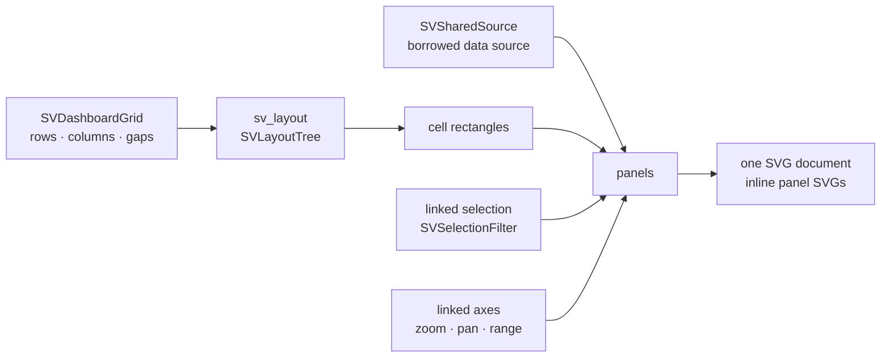

# Chapter 50 — Dashboards: many figures that behave as one

A chart answers one question. A *dashboard* answers a family of questions at
once: how the same observations look against three different variables, what a
region of one plot implies for the others, and how a zoom on a shared axis moves
every panel together. The hard part is not drawing the third plot. It is making
the set behave as one application without turning the plotting library into an
application framework.

`scienceview_dashboard` is a separate crate for exactly that reason. The core
figure and artist capabilities stay usable without it, and the crate composes
what already exists instead of pushing dashboard needs into the core API.



## A grid is a layout problem, not a CSS problem

`SVDashboardGrid::new(rows, columns)` declares the shape and two gaps.
Placement is a value: `SVGridPlacement::new(row, column)` optionally extended
with `with_row_span` and `with_column_span`. The grid never guesses a pixel
position. It builds a layout tree with one vertical root holding one horizontal
node per row and one fill cell per column, hands the tree to `sv_layout`, and
reads the solved rectangles back. A spanning cell is the union of the rows and
columns it covers, so a panel across two columns is exactly two columns wide.

That decision pays off twice. First, a viewport change is just another solve:
`SVDashboard::set_viewport` stores the new environment and the next render
re-resolves every cell, which the test
`the_viewport_change_re_solves_the_grid` pins by reading the widths of the same
panel at two viewports. Second, a dashboard cell sits on the same layout
contract as a figure, so a backend never needs a second geometry engine.

The builder validates what geometry cannot: a placement outside the grid is a
`DashboardPlacementOutOfBounds`, two panels in the same unit are
`OverlappingDashboardPanels`, and a duplicate identifier is a
`DuplicateDashboardPanel`. A dashboard that exists can be rendered.

## One source, many readers

`SVSharedSource::new("measurements", &table)` registers a borrowed
`SVDataSource` under an identifier. Panels bind to the identifier, not to the
table. The dashboard stores the reference once and never copies the storage.

Refresh is where fan-out becomes visible. `SVDashboard::refresh` walks the
registered sources, resolves the first column of each source **once**, drops the
snapshot immediately, and then records every panel bound to that source.
`a_shared_source_is_read_once_and_fans_out_to_both_panels` asserts the count:
two panels, one source read, two deliveries. The trigger is explicit —
`SVRefreshTrigger::Timer`, `Event { name }` or `Manual` — so the library owns no
wall clock and no async runtime; the host decides when a cycle happens.

## A selection is a description, never a copy

When a region is selected in one panel, the dashboard needs the columns that
region refers to. That is what an axis binding carries:

```rust
SVDashboardAxisBinding::new("sepal-width", SVControlAxis::Horizontal, "sepal_width")
```

The linked axis identifier coordinates zoom and pan; the column turns a
selection into a filter. `SVDashboardEvent::Selection { panel, region }` builds
an `SVSelectionFilter` over the panel's horizontal and vertical columns and
applies it to the shared filter state.

The filter is deliberately a *description*. `selected_indices` resolves each
column once into its current `SVColumnView` and reads values through
`value_at`, so a dense, sparse or streaming column is filtered without being
densified. The underlying storage pointer does not move:
`a_filtered_source_keeps_the_underlying_storage_untouched` records the pointer
before the selection and compares it after.

The filter state is shared by every panel reading the source and exposed to the
host through `filters()`, `filter_for` and `filter_for_panel`. That is the
specification's "filter observed by the host" requirement made concrete: the
host reads the same value the panels use, not a copy of it.

## Cycles are stopped, not hoped away

Linked selections can loop: panel A selects, panel B observes, B's observer
selects the same region again. `SVLinkedSelectionState` handles the loop with
two guards. Re-applying the same filter is a no-op, so the host is not notified
twice; and `apply_cascade` stops when a filter reappears in the same chain or
when the chain exceeds `cascade_depth_budget`, returning
`SVError::LinkedSelectionCycle` with the depth and the budget. The tests
`an_identical_linked_selection_is_a_no_op`, `a_reappearing_filter_ends_the_cascade_before_the_budget`
and `a_zero_depth_budget_stops_a_linked_selection_cycle` make those two guards
executable.

## Events travel by axis identifier

`SVDashboardEvent::AxisAction { axis, action }` carries the same
`SVControlAction` the control kit already defines. The dashboard finds the
linked axis, rejects an action whose `SVControlAxis` disagrees with the
registration (`DashboardAxisMismatch`), dispatches it into that axis's
`SVControlState`, and emits one delivery per bound panel. Every subscriber
receives the same previous and current range because the state is shared, not
replicated.

A `PanelAction` is routed through the panel's bindings: a zoom on the horizontal
axis goes to the linked axis the panel binds for horizontal, a reset goes to
every axis the panel binds, and a series or playback action is rejected with
`UnsupportedDashboardAction` naming the figure control session as the right
path. That keeps the dashboard's surface honest: it coordinates what it owns
and does not pretend to own the figure's series or timeline.

## One document, many panels

`render_svg` builds one `SVSvgDocument` at the dashboard viewport. For each
panel, in declaration order, it solves the cell rectangle, asks the content for
one `<svg>` fragment with a `viewBox`, and places the fragment by setting its
`x`, `y`, `width` and `height` while preserving the viewBox. A nested SVG with
its own viewBox scales exactly like the figure it came from; the test
`a_spanning_panel_occupies_both_columns` reads the placed width from the output
instead of trusting it.

Accessibility is structural, not decorative. The outer document carries a
`<title>`, a `<desc>` and an `aria-label`; every panel is wrapped in a
`<g role="group" aria-label="...">` and its nested SVG keeps its own title and
description. An empty dashboard still renders a valid document, which the test
`an_empty_dashboard_is_a_valid_accessible_document` asserts.

Determinism follows from the same discipline as the rest of the library: fixed
declaration order, one number format, no timestamps. Rendering the same
dashboard twice is byte-identical, and `concurrent_renders_produce_the_same_bytes`
renders it from eight threads and compares every result with the reference.

The `render-html` feature wraps the very same SVG in the self-contained HTML
page from `scienceview_html`; the backend kind is still explicit, recorded in
the operation span, and never inferred.

## What the example proves

`examples/dashboard_composition.rs` builds three real scatter recipes over one
`SVDataTable`, places them in a spanning two-by-three grid, registers two linked
axes and dispatches a selection. The example writes
`docs/figures/dashboard.svg`: a single self-contained document whose panels are
the actual recipe output, scaled into their cells. It is regenerated by the CI
figures job, so the chapter's picture cannot drift from the code.
