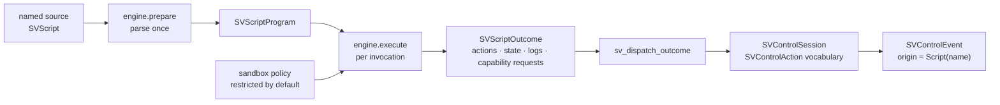

# Chapter 51 — Scripts: behaviour edited while the program runs

A compiled callback is fixed at build time. A scientist exploring a dataset
often wants to change *what happens when the range moves* without recompiling:
zoom differently, hide a series under a condition, pan by a different fraction.
The scripting capability is that seam. The first temptation is to embed a full
Lua virtual machine and a full JavaScript engine. That would put two heavy
dependencies — and two independent security surfaces — in the default build of a
library whose core is deliberately dependency-light. `scienceview_script` takes
a different road: the **engine is a trait**, and the shipped front-ends are
small, deterministic interpreters over a documented statement subset.

That choice is a limitation, and this chapter states it plainly: the built-in
interpreter does not run arbitrary Lua or JavaScript. It reads the statement
shapes a figure script needs — `dispatch`, `increment`, `log`, and four
capability calls — in each language's surface syntax. Everything the
specification actually asks of scripting is exercised by that subset: loading,
invoking, reloading, sandboxing, bounded execution and contained failure. A real
interpreter plugs into the same machinery through `SVScriptEngine` or the
narrower `SVHostScriptExecutor`.



## The engine contract: prepare and execute are different moments

`SVScriptEngine` has three methods. `kind` names the language. `prepare` turns a
source into an `SVScriptProgram` — the expensive step, done once — and is where a
parse failure belongs. `execute` runs a prepared program against an
`SVScriptExecution` and returns an `SVScriptOutcome`.

Splitting the two is what makes reload safe. `SVScriptRuntime::replace` prepares
the new source *before* touching the registry. If the new text has a typo, the
preparation fails with an `SVError::ScriptParseFailure` and the previous program
keeps running; the test
`a_replacement_that_fails_to_parse_leaves_the_old_program_running` asserts both
halves of that sentence. If preparation succeeds, the program is swapped under
the same lock that guards the script's state, so an invocation observes either
the old program or the new one, never a mixture.

The shipped engines are `SVLuaScriptEngine` and `SVTypeScriptScriptEngine`. One
shared interpreter (`SVDirectiveEngine`) does the work; the two front-ends differ
only in surface syntax. Lua reads `{ axis = "x" }` and `--` comments; TypeScript
reads `{ axis: "x" }` and `//` or `/* */` comments. Each front-end rejects the
other dialect's separator by name, which the test
`each_dialect_rejects_the_other_field_separator` makes explicit. TypeScript and
JavaScript share the front-end because the subset they share is the same
call-and-object syntax — preparation is not a type check.

## A third language is an implementation, not a fork

A pluggable engine must not force a rewrite of the registry. `SVHostScriptExecutor`
is the narrower contract for a *real* interpreter: it receives the source, the
triggering event, the sandbox policy and the budget, and returns an outcome.
`sv_host_executor_engine` adapts it to the full contract without reimplementing
preparation, reload, sandboxing or observability. The conformance test
`a_third_party_host_executor_plugs_in_through_the_adapter` wraps a trivial
executor and asserts that its action arrives in the outcome unchanged.

## Scripts speak the control vocabulary, not a private one

The most important design decision is that a script cannot invent a mutation.
Every action it produces is a `SVControlAction` — the same `Zoom`, `Pan`,
`Reset`, `ToggleSeries`, `SetSeriesVisibility`, `SetRange`, `SelectRegion`,
`ClearSelection`, `SetPlayback` and `Custom` values a built-in control
dispatches. A script writes:

```lua
dispatch("zoom", { axis = "x", factor = 0.5, anchor = 0.5 })
```

The parser resolves the action name and the field table into that typed action at
preparation time. An unknown name is `SVError::ScriptUnknownAction` carrying the
script identity and the source location; an unknown field is a
`ScriptRuntimeFailure` that names the accepted fields; an inverted range is
rejected by `SVControlRange::new` and reported the same way. `zoom_dispatches_through_the_control_vocabulary`
and `an_unknown_action_is_a_typed_error_with_its_span` are the executable
statement of that contract.

`sv_dispatch_outcome` then applies the produced actions to an `SVControlSession`
with `SVControlOrigin::Script(name)`. The session reducer, the clamped domains
and the event payloads are exactly the ones a button uses. The test
`script_actions_drive_the_control_session` registers the domain `0..10`, runs a
zoom with factor `0.5` and asserts the visible domain became `2.5..7.5` and that
the event origin is the script — no second mutation path exists.

## State, reload and the policy that decides

A script can keep its own persistent state through `increment("clicks", 1)`. The
state is a map owned by the registry entry, not by the script text, so a reload
has a choice to make. `SVScriptStatePolicy` makes it explicit: `Preserve` (the
default) keeps the values, `Reset` clears them. `reload_preserves_state_by_default_and_can_reset_it`
runs the script twice, replaces its source, and asserts the counter continues
from `2` to `12` under `Preserve` and restarts at `10` under `Reset`.

## The sandbox is the authority

A script starts restricted: it holds `SVSandboxCapability::Graphics` and nothing
else. `SVSandboxPolicy` has no "allow everything" switch — widening is additive
and names exactly one capability at a time. `read_file` and `write_file` need
`Filesystem`, `http_get` needs `Network`, `run_process` needs `Process`,
`read_environment` needs `Environment`. A restricted script that calls one of
them fails with `SVError::ScriptSandboxViolation` at the statement's own line and
column; `a_sandbox_refusal_does_not_terminate_the_runtime` proves that the failed
script stays registered and the runtime keeps serving other scripts.

The built-in interpreter performs no system access at all. A granted capability
call becomes an `SVScriptCapabilityRequest` in the outcome; the host adapter
decides how to service it. This is deliberate: the sandbox is enforced at the one
place every engine passes through, so a third-party interpreter cannot quietly
bypass it. `widening_grants_the_capability_request` checks the request's
capability and argument.

## Failures are values, and long scripts are bounded

Every failure is an `SVError` variant carrying the script name and an
`SVScriptLocation` — one-based line and column plus a zero-based byte span, so an
editor can underline the offending token. Nothing panics, and no error aborts the
host; the test suite registers a broken script, observes the typed error, then
runs a healthy one in the same runtime.

Execution is bounded too. One invocation may run at most
`statement_budget` statements (`SV_DEFAULT_STATEMENT_BUDGET` is 10 000, and the
builder rejects a budget of zero). A source with more statements than the budget
stops with `SVError::ScriptBudgetExceeded`; `a_long_script_is_bounded_by_the_statement_budget`
uses fifty log lines under a budget of eight.

## Concurrency, placement and the honest boundary

`SVScriptRuntime` takes `&self` for every operation and synchronises the registry
internally, so it can live behind an `Arc`. Each invocation holds the registry
lock while it runs and mutates that script's state, which makes an invocation
atomic with respect to a reload. `a_shared_runtime_serves_concurrent_invocations`
runs eight workers against four scripts and asserts every increment landed
exactly fifty times.

Placement mirrors the design decision: `SVScriptExecutionPlacement::Host` is the
default, and `Embedded` is rejected with
`SVError::UnsupportedScriptPlacement` unless the `embedded-execution` feature is
enabled. The flag only widens the contract; the artifact-side bridge belongs to
the WebAssembly backend.

Two things are intentionally absent. There is no embedded Lua or JavaScript
runtime: the shipped front-ends read a documented subset, and full-language
scripts require an `SVScriptEngine` implementation over a real interpreter. And
there is no figure drawing here: scripting produces actions, and the control
session applies them. The illustrative program
`crates/scienceview_script/examples/scripting_engines.rs` runs one Lua script and
one TypeScript script against the same state and prints the resulting visible
range, which is the capability in one screenful.
