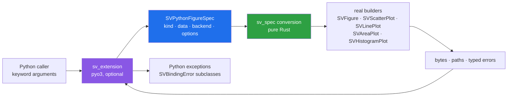

# Chapter 52 — Python: binding a surface that is already proven

The reference libraries this project measures itself against are Python
libraries. Until this chapter, the claim to cover them was structural: the same
recipes, the same styling, the same streaming model — but only a Rust caller
could use them. The binding closes that gap, and it is deliberately the last
node of the dependency graph. A binding is a translation of a validated surface,
not a second design, and nothing is bound before it is proven.

The temptation is to write Python wrappers around a fresh Python model: your own
data classes, your own backend enum, your own error hierarchy that string-matches
Rust messages. That is how two surfaces drift. This chapter takes the other
road: **one conversion layer owns the meaning, and the interpreter layer is
thin**.



## Two layers, for one practical reason

CI cannot assume a Python development environment. If the only testable part of
the binding required CPython, the project would either skip testing the binding
or make every contributor install headers to run `cargo test`. The crate is
therefore split:

- `sv_spec` is pure Rust. It owns the Python lists (they become `Vec<f64>`
  columns), describes a figure as a value, and calls the real builders. It
  compiles with no `pyo3`, and its tests are ordinary `cargo test` tests.
- `sv_extension` is behind the `python` Cargo feature. It translates Python
  keyword arguments into the specification, calls the pure layer, and maps
  `SVError` variants back to typed exceptions.

`pyo3` is optional and never enters the default build. The command that proves
it is boring on purpose:

```sh
cargo build -p scienceview_python                 # no pyo3
cargo build -p scienceview_python --features python
```

## The backend stays an explicit choice

Rust refuses to build a figure without `backend(...)`; the omission is the
`SVError::MissingBackendSelection` value, not a default. Python mirrors that
rule, and the constructor is the Python caller's `build`:

```python
import scienceview as sv

figure = sv.scatter_plot(
    {"x": [0, 1, 2, 3], "y": [1, 4, 2, 5]},
    backend="svg",       # required — no automatic fallback
    x="x",
    y="y",
)
```

```python
sv.scatter_plot({"x": [1.0], "y": [1.0]}, x="x", y="y")
# raises SVBackendSelectionError
```

The accepted names are the stable lowercase names of `SVBackendKind`:
`svg`, `html`, `tui`, `native`, `wasm`, `react`, `vue`, `angular`, `tauri`,
`dioxus`. There is no `automatic` among them, and `backend_kinds()` returns the
list so a caller can check. Enabling a backend feature only makes a provider
available; `sv_register_available_backends()` registers providers at module
import, and the selection still decides which one renders.

## The three representations, unchanged

The data boundary is the part of the library most likely to be flattened by a
binding: it is tempting to accept only NumPy-like arrays and copy everything
into one buffer. The binding keeps the representations instead.

- A dictionary of columns becomes `SVPythonTable`, an owned source that
  implements `SVDataSource` and returns dense views borrowed from itself.
- `SparseColumn(indices, values, length)` becomes `SVSparseView` — the indices
  are preserved and never expanded. The companion test builds the same logical
  values densely and sparsely and asserts that both scatter documents are byte
  identical.
- `StreamingColumn(capacity=...)` owns a bounded `SVRollingWindow`. `push`
  appends samples and advances the sequence number; a read takes the retained
  window under the window lock and never waits for a producer. Pushing more than
  the capacity drops the oldest sample, and `dropped_samples` reports how many.

```python
live = sv.StreamingColumn(capacity=128)
live.push([1.0, 2.0, 3.0])
figure = sv.scatter_plot(live, backend="svg", x="index", y="value")
figure.render()            # the current window
live.push([4.0, 5.0])      # the producer advances
figure.update(appended_points=2)
```

The two entry points differ here, and the difference is real. The generic
`figure()` path declares `requires_streaming` and asks the backend for its own
in-place update; an export-only backend such as SVG does not implement that
capability, so the core capability matrix rejects it with `SVBackendError`,
exactly as it rejects the same combination in Rust. A recipe such as
`scatter_plot()` instead composes a scene from the current window on every
render, which is why the example and the streaming tests use it with
`backend="svg"` and why `update()` there re-renders the advanced window rather
than calling a backend update.

## Errors are values, all the way to Python

Every failure already exists as a typed `SVError`. The binding maps categories,
not strings:

| Rust variant family | Python exception |
| --- | --- |
| `MissingBackendSelection` | `SVBackendSelectionError` |
| `MissingDataSource`, column/length/sparse failures | `SVDataError` |
| `InvalidConfiguration`, unsupported representation, control and dashboard-grid failures | `SVConfigurationError` |
| backend unavailable, missing capability, backend failure | `SVBackendError` |
| scripting failures | `SVScriptError` |

All of them inherit `SVBindingError`, so a coarse `except SVBindingError` still
catches everything. The class hierarchy is the reason a caller can distinguish
“I forgot the backend” from “this backend cannot stream” without parsing text.

## Options, dashboard and controls

The option catalogue is data, not documentation that rots: `options_for(kind)`
returns each keyword, whether it is required and what it changes, and the parity
test builds every kind with every catalogued option. A keyword a kind does not
bind is an error instead of being silently ignored.

`dashboard(panels, rows, columns, backend=...)` composes figure objects into the
dashboard crate's grid; each panel embeds the bound figure's SVG fragment, so a
dashboard is rendered by the same conversion path as a single figure. Controls
are exposed as `ControlState`, which dispatches the same `SVControlAction`
vocabulary — `zoom`, `pan`, `reset`, `series`, `clear_selection` — through the
same reducer a Rust widget uses.

## The figure this chapter generated

The figure below is not drawn by hand: `examples/python_bindings.py` builds it
through the installed wheel and writes it to `docs/figures/python_bindings.svg`.
The Rust figures job cannot rerun a Python program, so this one is regenerated
deliberately:

```sh
maturin build --release              # in crates/scienceview_python
python -m pip install --force-reinstall target/wheels/scienceview-*.whl
python examples/python_bindings.py   # rewrites docs/figures/python_bindings.svg
```

Running those three commands reproduces the committed figure byte for byte;
the mirrored copy under `docs/src/assets/` is the same file.

```python
figure = sv.scatter_plot(
    {"sepal_width": SEPAL_WIDTH, "petal_length": PETAL_LENGTH, "species": SPECIES},
    backend="svg",
    x="sepal_width",
    y="petal_length",
    series="species",
    title="Bound scatter: sepal width against petal length",
    x_label="sepal width",
    y_label="petal length",
)
```


## Packaging and the tests that keep it honest

`pyproject.toml` selects maturin and the `python` feature; maturin enables PyO3's
`extension-module` behaviour itself. A wheel is built with `maturin build --release`; `maturin develop` installs into a
virtual environment. The extension module is named `scienceview`, so `import
scienceview` reaches the binding.

The interpreter tests are gated twice — by the `python-tests` feature and by the
`SCIENCEVIEW_PYTHON_TESTS` environment variable — so the default workspace test
run never needs CPython. Where an environment exists, they run the same
scenarios from Python: builder parity, the typed missing-backend exception, a
pushed window re-rendering, control dispatch and the option catalogue. The pure
layer carries the semantics in every other environment.

The honest limitation is the bound recipe set: each recipe needs an adapter that
applies its options to its builder. The binding ships `figure`, `scatter`,
`line`, `area` and `histogram`; `plot_kinds()` reports exactly those, and a kind
without an adapter cannot be constructed, so the surface never silently
approximates a chart.
