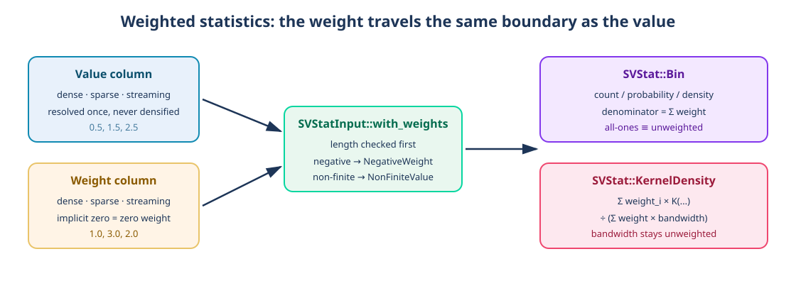

# Chapter 53 — Weights: when one observation counts for several

A histogram counts observations. A density estimates how they are spread. Both
answers change the moment one observation is worth more than another: a survey
row that represents a thousand people, a sensor reading that averages a burst,
a repeated measurement that should not vanish into a single tally. The
mechanism that expresses "this observation counts for this much" is an
**observation weight**.

This chapter tells the story of weighted statistics in `sv_stat`: why the
weight is a column rather than a number attached to a row, how the kernel reads
it without densifying a sparse column or blocking on a stream, what a weighted
count, probability and density mean, and why the bandwidth of a weighted
density deliberately stays unweighted. Every claim is grounded in
`crates/scienceview_core/src/stat/weights.rs`, the kernel tests beside it, and
the two recipes that expose the option:
`SVHistogramPlot::weight` and `SVDensityPlot::weight`.



## From zero: what a weight is

Without weights, every observation contributes exactly one. A bin count is the
number of observations that fell into the bin; a probability divides that count
by the total number of observations; a density divides by the total count times
the bin width, so the area under the histogram is one.

A weight changes the *contribution*, not the *position*. An observation at
`0.5` with weight `3.0` still falls into the same bin, but it adds `3.0` to
that bin instead of `1.0`. The total is now the **sum of weights**, not the
number of rows:

```
weighted count(bin)      = Σ weight of the observations in the bin
weighted probability     = count(bin) / Σ weight of every observation
weighted density         = count(bin) / (Σ weight × bin width)
```

Two properties follow from that definition and are worth stating before any
code:

- **All-ones equality.** If every weight is `1.0`, every formula above reduces
  to the unweighted one. A weighted implementation that disagrees with the
  unweighted path on ones is wrong, and the tests pin it
  (`all_ones_weights_reproduce_the_unweighted_counts_exactly`,
  `all_ones_weights_reproduce_the_unweighted_density_exactly`).
- **Scale invariance.** Multiplying every weight by the same constant changes
  nothing after normalisation. Only the *ratios* between weights carry
  information, which is why a negative weight is meaningless and rejected
  rather than clamped.

Kernel density adds one more step: each observation contributes a kernel —
a small bell curve — centred on its value. Its weight multiplies that kernel.
The estimate is then divided by the total weight times the bandwidth so it
still integrates to one:

```
density(x) = (1 / (Σ weight × bandwidth)) × Σ weight_i × K((x − value_i) / bandwidth)
```

## Why the weight is a column, not a field

The library's data boundary (`openspec/specs/data-view-boundary/spec.md`) says
that a column may be dense, sparse or streaming, and that a kernel dispatches
on that representation **exactly once per operation** without densifying a
sparse column or blocking on a stream. A weight is data, so it gets the same
treatment: `SVStatInput::with_weights` attaches a second `SVColumnView`, and
`weights.rs` folds it into the same walk the kernel already takes.

That decision has three visible consequences:

1. **Sparse stays sparse.** A position without a stored weight carries zero
   weight, so an implicit zero in the weight column is simply a zero-weight
   observation. Nothing is materialised — the fold visits stored entries and
   treats the implicit run as one weighted contribution
   (`weighted_sparse_implicit_zeros_use_their_own_weights` in both
   `bin_tests.rs` and `density_tests.rs`).
2. **Streaming stays bounded.** A streaming weight column is read from the
   same rolling window as the value column. The window is the contract; the
   kernel never waits for more.
3. **The validation is one place.** `sv_validate_weights` checks the length
   first, then walks the stored weights once, rejecting the first negative or
   non-finite entry at its logical position:

```rust
pub(crate) fn sv_validate_weights(
    values: &SVObservationValues<'_>,
    weights: &SVObservationValues<'_>,
    operation: &'static str,
) -> Result<(), SVError>
```

A length mismatch is `SVError::MismatchedStatisticLengths`; a non-finite
weight is `SVError::NonFiniteValue`; a negative weight is
`SVError::NegativeWeight`. Every message names the operation and the position,
which is what makes a wrong weight column diagnosable in a chart with a
million rows.

## The bandwidth is not weighted

Silverman's rule of thumb derives a bandwidth from the spread of the data and
the number of observations. A tempting next step is to feed it the total
weight instead of the count. The shipped implementation deliberately does not:
the weight describes how much an observation contributes to the *estimate*,
not how spread its value is, and letting a weight inflate the effective sample
size silently changes the smoothness of every chart that adopts weights.
The rule stays unweighted, the decision is recorded in FDR-002, and the
weighted estimate still integrates to one
(`a_weighted_density_integrates_to_one`).

## How the recipes expose it

`SVStat` is a kernel; a reader draws a recipe. Two recipes carry the option:

- `SVHistogramPlot::weight("weight")` names a weight column. The builder keeps
  it aligned with the value column through series splitting and missing-value
  omission, then hands both to `SVStat::Bin`. Count, probability and density
  heights now use the weighted definitions above; the bin edges themselves are
  unchanged, because a weight moves mass between bins, not the boundaries.
- `SVDensityPlot::weight("weight")` names a weight column per series. The
  column is resolved once, and a stored sparse entry that is dropped for a
  missing value carries a zero weight instead of being removed from a dense
  buffer — the sparse form is never rebuilt as dense.

Neither recipe reimplements the weighted fold. That is the whole point of
P5 in `docs/FDRs/patterns.md`: a recipe composes closed kernels and never
grows a private variant of one.

## The walkthrough: what the companion tests prove

Read the tests as the specification:

| Test | What it fixes in place |
|---|---|
| `weighted_counts_accumulate_the_observation_weights` | a bin adds the weight, not one |
| `all_ones_weights_reproduce_the_unweighted_counts_exactly` | the degenerate case cannot drift |
| `weighted_probability_divides_by_the_total_weight` | the denominator is the weight sum |
| `weighted_density_divides_by_the_total_weight_and_the_bin_width` | area still equals one |
| `weighted_sparse_implicit_zeros_use_their_own_weights` | an implicit zero weights nothing |
| `a_weight_column_of_a_different_length_is_rejected` | misalignment is an error, not a silent truncation |
| `all_ones_weights_reproduce_the_unweighted_density_exactly` | KDE degenerates cleanly |
| `a_weighted_density_integrates_to_one` | the normalisation is right |
| `weighted_bin_counts` (parity) | dense, sparse and streaming agree |
| `weighted_kernels_agree_across_threads` | no hidden global state |

The parity helper is worth a look: it accepts an `SVColumnView` for both the
value and the weight, so the same test body runs three times with three
representations, and the assertion is equality, not a tolerance.

## Roads not taken

- **Weights inside each recipe.** Rejected: every recipe would have had to
  reproduce the same normalisation, and the three representations would have
  diverged. The kernel owns it once.
- **Weights as a `Vec<f64>`.** Rejected by the data boundary: it forces a copy
  and makes a sparse weight column impossible to express without densifying it.
- **Weighted percentiles, ECDF and fits.** Not in this change. Each needs its
  own definition (a weighted quantile is a different estimator, a weighted fit
  changes the normal equations), so each is a kernel change with its own spec
  delta rather than an implicit side effect of accepting a weight column.
  Those kernels reject a configured weight instead of ignoring it.
- **Weighted bandwidth.** Rejected for the reason above; it is an estimator
  question, not a data-boundary question.
