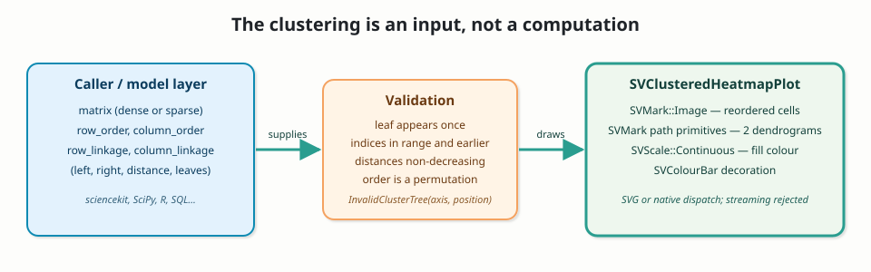

# Chapter 54 — Clustered heatmaps: when the clustering is the input

A heatmap draws a matrix: rows on one axis, columns on the other, colour in
each cell. In its natural order it answers "what is the value here?" but hides
"which rows belong together?" A **clustered heatmap** answers both: it
reorders the rows and columns so that similar ones sit side by side, and it
draws a **dendrogram** — a tree of merges — beside each axis.

The obvious next sentence would be "and the library computes the clustering".
This chapter tells the opposite story, and explains why that is the stronger
design: `SVClusteredHeatmapPlot` **renders a supplied clustering**. The caller
provides the matrix, the two leaf orders and the two merge trees. The recipe
validates them and draws them. It never runs a clustering algorithm, a distance
metric or a linkage rule.



## From zero: heatmap, order, tree

Start with the vocabulary, because the rest of the chapter depends on it.

- A **matrix** has a fixed number of rows and columns. A cell is addressed by
  an original `(row, column)` pair. That pair is the cell's identity.
- An **order** is a permutation: a list that says which original row occupies
  slot 0, slot 1, and so on. If the row order is `[2, 0, 1]`, the first drawn
  row is the original row 2. The order changes positions, not identities.
- A **merge tree** (also called a linkage or a dendrogram) is a binary tree of
  merges. A leaf is an original row or column. A merge joins two earlier nodes
  at a **distance**. Repeating merges until one root remains produces the tree
  whose height is the distance.
- A **dendrogram** is the drawing of that tree: leaves at the cell edge,
  horizontal (or vertical) arms joining them at their merge height.

Hierarchical clustering is the algorithm that *produces* the order and the
tree from data. That algorithm is a statistical model-learning concern.

## Why the recipe does not cluster

The original FDR delegated the clustering to `sciencekit`, the sibling project
that "learns the models". But the published `sciencekit_cluster` exposes only
`KMeans`, `MiniBatchKMeans` and `DBSCAN`. None of them returns a leaf order and
a merge tree: k-means returns centroids and labels, DBSCAN returns density
labels. There is no linkage routine.

The project DAG forbids reimplementing linkage inside `scienceview`. Importing
a clustering crate would make a visualization library own a model, and the
closed-kernel rule (`patterns.md` P5) says a recipe composes existing kernels
rather than inventing a stat. So the contract changed, explicitly:

```
caller: matrix + row_order + column_order + row_linkage + column_linkage
recipe: validate -> reorder the cells -> draw the cells -> draw the trees
```

This is not a narrowing hidden in the implementation. FDR-136 was rewritten,
the OpenSpec capability was rewritten, and the ADR records the decision and
its consequences. A future hierarchical-clustering kernel in `sciencekit` can
be plugged at the call site without touching this chart, because the chart
already speaks the only language it needs: "matrix, order, tree in; figure
out".

The supplied-clustering contract also buys determinism. Given the same order
and the same tree, the figure is byte-for-byte identical, which is why the
concurrency test can assert equality rather than a tolerance.

## The public objects

The recipe lives at `src/recipes/matrix/clustered_heatmap_plot/`, and
`mod.rs` is a pure dispatcher: declarations and re-exports only. The public
path is:

```rust
use scienceview::sv_recipes::sv_matrix::sv_clustered_heatmap_plot::{
    SVClusterMerge, SVClusterTree, SVClusteredHeatmapPlot, SVHeatmapMatrix,
};
```

- `SVHeatmapMatrix` is the borrowed dense matrix already used by
  `SVHeatmapPlot`: values, rows, columns, no copy.
- `SVClusterMerge` is one merge record: `left`, `right`, `distance`,
  `leaf_count`. A leaf is an index below the axis dimension; an internal node
  is `dimension + merge_position`, so the first merge of a six-leaf axis is
  node 6.
- `SVClusterTree` borrows a slice of merge records for one axis.
- `SVClusteredHeatmapPlot` is the built figure. `SVClusteredHeatmapPlotBuilder`
  is the only constructor, `backend(...)` is required and
  `execution_mode(...)` defaults to `Automatic`.

A complete configuration:

```rust
let tree = SVClusterTree::new(&MERGES);
let scene = SVClusteredHeatmapPlot::builder()
    .matrix(matrix)
    .row_labels(&ROW_LABELS)
    .column_labels(&COLUMN_LABELS)
    .row_order(&ROW_ORDER)
    .column_order(&COLUMN_ORDER)
    .row_linkage(tree)
    .column_linkage(tree)
    .centre(4.25)
    .title("Expression matrix reordered by a supplied clustering")
    .backend(SVBackendKind::Svg)
    .build()?
    .compose()?;

let document = scene.to_svg()?;
```

`compose()` returns `SVClusteredHeatmapScene`. Its cells are
`SVClusteredHeatmapCell` values carrying both the new `slot_row` /
`slot_column` and the surviving `original_row` / `original_column`. The two
dendrograms are `SVDendrogram` values whose `merges()` expose the supplied
distance, the child distances and the normalized leaf positions. That is how
the tests can verify that the drawing really reproduces the input.

## Validation is the contract

A tree is data supplied by the caller, so it can be wrong. Before drawing
anything, the recipe checks, per axis:

1. a binary tree over `n` leaves has exactly `n - 1` merges;
2. every leaf appears exactly once across the merges;
3. a child index is in range and refers to an earlier leaf or merge;
4. a merge distance is finite, non-negative, and not shorter than either
   child's distance;
5. the declared leaf count equals the sum of the children's leaf counts;
6. the order is a permutation of the axis dimension, with the right length.

A violation is not a string in a log. It is a typed value:

```rust
SVError::InvalidClusterTree { axis, position, message }
```

where `axis` is `"row"` or `"column"` and `position` is the failing merge.
The tree tests assert the exact variant and position for a duplicated leaf,
an out-of-range child, a decreasing distance and a wrong leaf count; a
non-permutation order is reported the same way, and a wrong order length is
`SVError::MismatchedLengths`.

Two further errors make the configuration honest: requesting the dendrogram
without both trees is `InvalidConfiguration` (call `dendrogram(false)` to draw
the cells alone), and an unsupported backend is `UnsupportedMark` at `build`
or `UnsupportedBackendCapability` at `render`, never a silently empty figure.

## The data boundary: sparse in place, streaming refused

A dense matrix is already row-major. A long table with `row`, `column` and
`value` columns is pivoted through `SVStat::Aggregate`, exactly the stat the
FDR composition names. Duplicate `(row, column)` observations are aggregated
into one cell.

Sparse is accepted. The pivot dispatches on the value column exactly once and
walks its stored entries; an implicit zero is simply a cell that is not
stored, so nothing is densified. The parity test builds a sparse column with
three stored cells out of nine and asserts both the `Sparse` representation
and exactly three drawn cells.

Streaming is different. Reordering is a **static-only exception** under
`data-view-boundary`: the supplied order and tree describe one whole matrix
snapshot, and a live window has no stable leaf identity to draw. The recipe
rejects a streaming source in `build`, before composition, with:

```text
UnsupportedRepresentation {
    operation: "SVClusteredHeatmapPlot",
    representation: Streaming,
    alternative: "take a snapshot of the current window, compute the
                  clustering outside scienceview, then render that snapshot",
}
```

This is why the capability has no "dense, sparse and streaming agree"
requirement. That old sentence contradicted the static-only exception; the
new spec states the exception and the alternative instead.

## Drawing: cells, paths and one span

The composition reuses the heatmap's matrix and the continuous colour scale.
Each prepared cell is looked up in the inverse order — `slot_of_original` —
and drawn in its new slot. The colour scale is built once from every finite
value, honours `centre`, and feeds both the cells and the colour bar. The
dendrograms are `SVMark` path primitives: for each merge, a path runs from the
left child at its height to the parent height, across to the right child, and
down to the right child's height. Row distances grow leftwards from the cell
edge; column distances grow upwards.

Every public operation runs inside one `scienceview.operation` span. The span
records the configured backend kind, the resolved representation and the
number of drawn cells; after composition the point count is updated to the
real cell count. `observability_tests` captures the span and asserts
`backend.kind = svg`, `representation = Dense`, `points = 9` and
`outcome = success`.

## What the tests teach

The companion tests are the executable source of truth, and each one states a
property rather than an implementation detail:

- `clustered_heatmap_plot_tests::the_default_configuration_draws_every_cell_in_the_supplied_order`
  checks the reordered labels; `::every_cell_keeps_its_identity_while_moving_to_its_slot`
  checks that the cell at slot `(0, 0)` still reports original row 2 and
  column 1.
- `::the_row_dendrogram_reproduces_the_supplied_merge_distances` and
  `::the_column_dendrogram_reproduces_the_supplied_merge_distances` compare
  the resolved dendrogram with the supplied numbers.
- `::the_matrix_input_and_the_long_table_paint_the_same_cells` asserts that the
  dense matrix and the pivoted table produce identical cells and identical
  SVG.
- `tree_tests` walks the typed error for each malformed tree.
- `parity_tests` covers the sparse path, the streaming refusal and the missing
  column.
- `concurrency_tests` renders the same figure from eight threads and compares
  the SVG byte for byte, and `observability_tests` pins the span fields.

The example program is `examples/clustered_heatmap_plot.rs`. Its merge trees
are written by hand and commented as precomputed input: two gene families for
the rows, two sample groups for the columns. The figure below is generated by
running that example, never drawn by hand.


## Decisions and roads not taken

- **Bundled clustering.** Rejected: it would duplicate a model-learning
  responsibility and violate the DAG. The supplied-clustering contract keeps
  the library a renderer.
- **A `method`/`metric`/`linkage` option.** Removed: those options describe a
  computation the recipe does not perform. They survive only in the caller's
  clustering tool.
- **Silently degrading a missing tree.** Rejected: a requested dendrogram
  without its tree is an explicit configuration error, so a figure never loses
  a visual channel without saying so.
- **Densifying a sparse column to make the order easy.** Rejected: the pivot
  reads stored entries and the scene reports the `Sparse` representation.
- **Accepting a stream and freezing a frame.** Rejected: it would hide that the
  order and tree describe a snapshot. The typed error names the documented
  alternative instead.

Transitions are deliberately deferred. The scene already carries
transition-ready geometry — cell identity survives the reorder and the paths
are recomputed from the new supplied tree — but wiring the transition and
animation layers is a later integration, and this chapter claims no animation
acceptance item.
