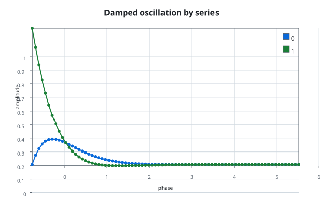
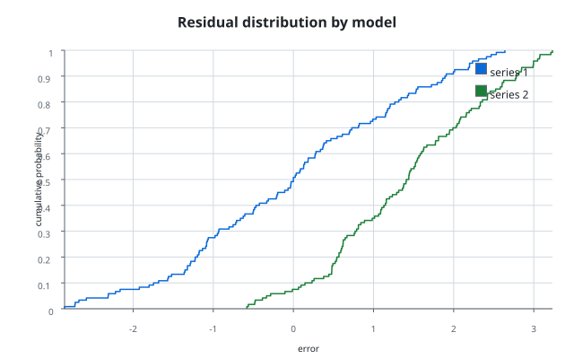
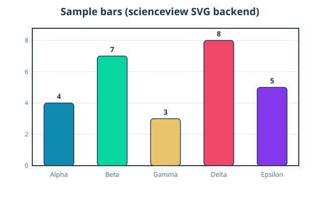
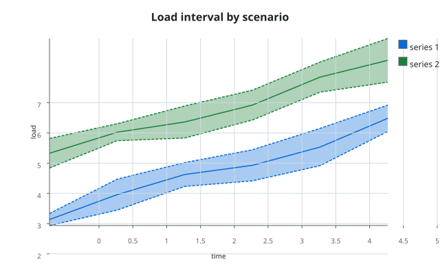
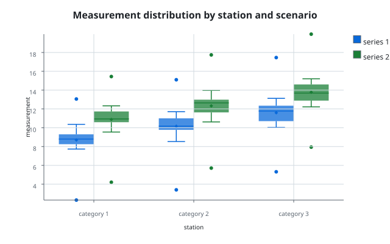
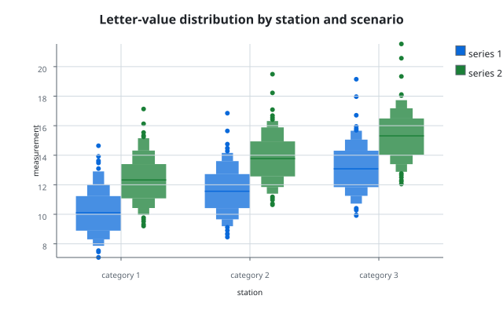
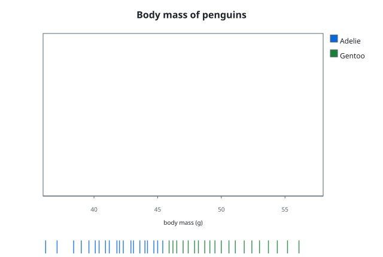
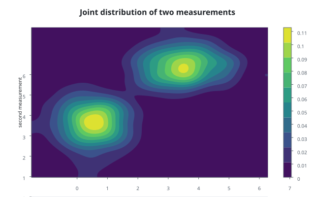
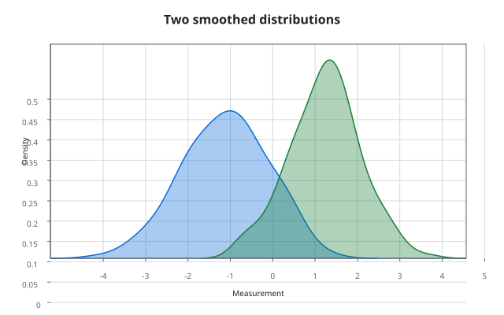

# Examples

Every example in this chapter is a runnable program under `examples/` whose
figure is generated by the tool itself. The figures are produced by the code
on the `main` branch, which keeps them under `docs/figures/`; this book keeps
a mirrored copy under `docs/src/assets/` so that the published book is
self-contained and pinned to the revision that produced the figures.

Regenerate the figures from the code branch:

```sh
cargo run --example line_plot_svg
cargo run --example bar_chart_svg
cargo run --example band_plot
cargo run --example box_plot
cargo run --example area_plot
cargo run --example ecdf_plot --features render-svg
cargo run --example scatter_plot --features render-svg
cargo run --example rug_plot --features render-svg
cargo run --example histogram_plot --features render-svg
cargo run --example line_plot
cargo run --example density_plot --features render-svg
```

The `figures` job of the code pipeline reruns these commands and fails on any
diff, and the pipeline of this branch regenerates them again to check the
mirrored copies, so neither the code nor the book can drift from what the tool
actually produces.

## Line plot

`examples/line_plot_svg.rs` builds a figure and renders it through the
registered self-contained SVG backend:

```rust,ignore
sv_register_svg_backend();
let figure = SVFigureBuilder::new()
    .data_source(SVColumnView::Dense(&samples))
    .backend(SVBackendKind::Svg)
    .title("Sine wave (scienceview SVG backend)")
    .build()?;
let bytes = figure.render()?.bytes;
```


## Line plot recipe

`examples/line_plot.rs` builds the `SVLinePlot` recipe — two series, markers and
a line width — composes its marks and decorations, and serializes the result
with `SVSvgDocument`:

```rust,ignore
let plot = SVLinePlotBuilder::new()
    .x(SVColumnView::Dense(&x))
    .y(SVColumnView::Dense(&y))
    .series(SVColumnView::Dense(&series))
    .markers(true)
    .backend(SVBackendKind::Svg)
    .build()?;

let composition = plot.compose()?;
let mut document = SVSvgDocument::new(composition.viewport())
    .with_title(composition.title().unwrap_or("A line plot"));
document.push_decoration_primitives(composition.decorations());
composition.visit_mark_geometries(|geometry| document.push_mark_geometry(geometry))?;
```



## ECDF plot

`examples/ecdf_plot.rs` composes two empirical cumulative distributions with
`SVECdfPlotBuilder` and writes the document through the public serializer:

```rust,ignore
let document = SVECdfPlotBuilder::new()
    .data_source(&table)
    .value("error")
    .series("model")
    .title("Residual distribution by model")
    .backend(SVBackendKind::Svg)
    .build()?
    .render()?
    .to_svg()?;
```



## Bar chart

`examples/bar_chart_svg.rs` renders sample values through the self-contained
SVG backend:

```rust,ignore
let figure = SVFigure::builder()
    .backend(SVBackendKind::Svg)
    .execution_mode(SVExecutionMode::Automatic)
    .build();
figure.render();
```



## Scatter plot

`examples/scatter_plot.rs` drives the `SVScatterPlot` recipe, which composes
the scales, the dot marks, the series palette and the decorations, and then
serializes the backend-agnostic scene through the public `to_svg()` method —
the program contains no serializer of its own:

```rust,ignore
let scene = SVScatterPlot::builder()
    .data_source(&table)
    .x("sepal_width")
    .y("petal_length")
    .series("species")
    .series_labels(&["setosa", "versicolor", "virginica"])
    .size("body_mass")
    .alpha(0.85)
    .title("Sepal width against petal length")
    .backend(SVBackendKind::Svg)
    .build()?
    .compose()?;
let document = scene.to_svg()?;
```


## Band plot

`examples/band_plot.rs` composes the `SVBandPlot` recipe in its derived mode:
`SVStat::Aggregate` turns observations into a mean and a standard-deviation
interval per group, and the recipe fills the region between the two
boundaries, one band per scenario:

```rust,ignore
let plot = SVBandPlotBuilder::new()
    .data_source(&table)
    .x("time")
    .derive()
    .values("load")
    .series("scenario")
    .border(true)
    .centre_line(true)
    .title("Load interval by scenario")
    .backend(SVBackendKind::Svg)
    .build()?;

let output = plot.render()?;
```


## Box plot

`examples/box_plot.rs` composes the `SVBoxPlot` recipe: `SVStat::Percentile`
supplies the quartiles and the median, `SVWhiskerRule::Tukey` chooses the
whisker ends and the outliers, and `SVMove::Dodge` places one box per scenario
inside each station:

```rust,ignore
let plot = SVBoxPlotBuilder::new()
    .data_source(&table)
    .value("measurement")
    .category("station")
    .series("scenario")
    .show_mean(true)
    .show_outliers(true)
    .title("Measurement distribution by station and scenario")
    .backend(SVBackendKind::Svg)
    .build()?;

let output = plot.render()?;
let document = output.to_svg()?;
```


## Boxen plot

`examples/boxen_plot.rs` composes the `SVBoxenPlot` recipe: `SVStat::Percentile`
supplies the nested letter values, `SVBoxenTailRule::Tukey` derives the depth,
and `SVMove::Dodge` places one nest per scenario inside each station:

```rust,ignore
let plot = SVBoxenPlotBuilder::new()
    .data_source(&table)
    .value("measurement")
    .category("station")
    .series("scenario")
    .show_outliers(true)
    .title("Letter-value distribution by station and scenario")
    .backend(SVBackendKind::Svg)
    .build()?;

let output = plot.render()?;
let document = output.to_svg()?;
```


## Area plot

`examples/area_plot.rs` builds a stacked three-series `SVAreaPlot` and
serializes the composed primitives with `SVSvgDocument`:

```rust,ignore
let plot = SVAreaPlot::new()
    .data_source(&table)
    .x("month")
    .y("revenue")
    .series("channel")
    .stack(true)
    .opacity(0.55)
    .backend(SVBackendKind::Svg)
    .build()?;
let rendering = plot.rendering()?;
```


## Rug plot

`examples/rug_plot.rs` builds the `SVRugPlot` recipe: one small tick per body
mass observation, coloured by species, in the margin of the axis the values
occupy. The scene is serialized through the public `to_svg()` method:

```rust,ignore
let scene = SVRugPlot::builder()
    .data_source(&table)
    .value("body_mass")
    .series("species")
    .series_labels(&["Adelie", "Gentoo"])
    .height(0.08)
    .alpha(0.85)
    .title("Body mass of penguins")
    .value_label("body mass (g)")
    .backend(SVBackendKind::Svg)
    .build()?
    .compose()?;
let document = scene.to_svg()?;
```


## Density contour plot

`examples/density_contour_plot.rs` builds an `SVDensityContourPlot`. The recipe
derives the joint density with the bin kernel on both axes, isolates the levels
with marching squares and fills each band from the lowest level up:

```rust,ignore
let plot = SVDensityContourPlot::builder()
    .data_source(&table)
    .x("first measurement")
    .y("second measurement")
    .grid_count(96)
    .bandwidth(0.35)
    .levels(9)
    .backend(SVBackendKind::Svg)
    .build()?;
let composition = plot.compose()?;
```


## Density plot

`examples/density_plot.rs` builds the `SVDensityPlot` recipe — two groups, a
filled curve and its outline — and writes the figure through the public
`save` operation:

```rust,ignore
let plot = SVDensityPlot::new()
    .data_source(&table)
    .value("measurement")
    .series("group")
    .fill(true)
    .bandwidth_adjustment(1.2)
    .backend(SVBackendKind::Svg)
    .build()?;
plot.save(Path::new("density_plot.svg"))?;
```

`SVStat::KernelDensity` supplies the grid, the density and the bandwidth;
`kernel`, `grid_count`, `cut`, `bandwidth_adjustment` and `normalise` select the
estimate.


