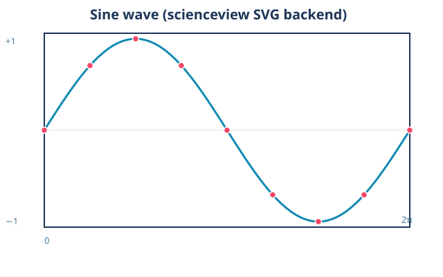
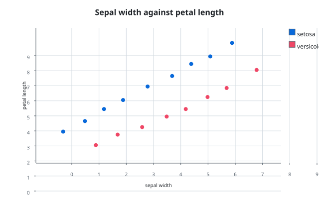
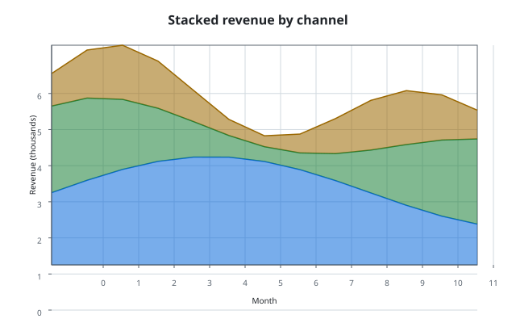

# Examples

Every example in this chapter is a runnable program under `examples/` whose
figure is generated by the tool itself. The figures are produced by the code
on the `main` branch, which keeps them under `docs/figures/`; this book keeps
a mirrored copy under `docs/src/assets/` so that the published book is
self-contained and pinned to the revision that produced the figures.

Regenerate the figures from the code branch:

```sh
cargo run --example line_plot_svg
cargo run --example bar_chart_svg
cargo run --example scatter_svg
cargo run --example area_plot
```

The `figures` job of the code pipeline reruns these commands and fails on any
diff, and the pipeline of this branch regenerates them again to check the
mirrored copies, so neither the code nor the book can drift from what the tool
actually produces.

## Line plot

`examples/line_plot_svg.rs` builds a figure and renders it through the
registered self-contained SVG backend:

```rust,ignore
sv_register_svg_backend();
let figure = SVFigureBuilder::new()
    .data_source(SVColumnView::Dense(&samples))
    .backend(SVBackendKind::Svg)
    .title("Sine wave (scienceview SVG backend)")
    .build()?;
let bytes = figure.render()?.bytes;
```



## Bar chart

`examples/bar_chart_svg.rs` renders sample values through the self-contained
SVG backend:

```rust,ignore
let figure = SVFigure::builder()
    .backend(SVBackendKind::Svg)
    .execution_mode(SVExecutionMode::Automatic)
    .build();
figure.render();
```


## Scatter plot

`examples/scatter_svg.rs` composes the pipeline explicitly — data source,
scales, dot marks, axes, grid and legend — and serializes the result with
`SVSvgDocument`:

```rust,ignore
let document = SVSvgDocument::new(SVViewport::new(640.0, 400.0))
    .with_title("Sepal width against petal length")
    .with_mark_geometry(&mark.geometry(&request)?)
    .with_decoration_primitives(axis.primitives())
    .with_decoration_primitives(grid.primitives())
    .to_svg();
```



## Area plot

`examples/area_plot.rs` builds a stacked three-series `SVAreaPlot` and
serializes the composed primitives with `SVSvgDocument`:

```rust,ignore
let plot = SVAreaPlot::new()
    .data_source(&table)
    .x("month")
    .y("revenue")
    .series("channel")
    .stack(true)
    .opacity(0.55)
    .backend(SVBackendKind::Svg)
    .build()?;
let rendering = plot.rendering()?;
```


