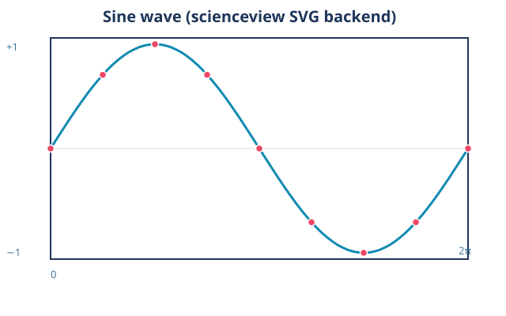

# scienceview

Scientific visualization for Rust, in the same family as [`sciencekit`](https://github.com/neurono-ml/sciencekit) ([docs](https://neurono-ml.github.io/sciencekit/)): `sciencekit` learns the models, `scienceview` draws them.

`scienceview` covers the capabilities of the most popular Python plotting
libraries — the same styling and interactivity — plus streaming data updates.
Every figure is built through a builder, and every builder requires an
explicit backend selection via `backend(...)` with an `SVBackendKind` value:
there is no automatic backend. Rendering is commanded by the `SVRenderBackend`
trait; each backend is a Cargo feature mapping 1:1 to a workspace crate under
`crates/scienceview_*` (SVG, HTML, WebAssembly, terminal TUI, React, Vue.js
and Angular components, Tauri and Dioxus native targets), so new backends —
including third-party crates — plug in without touching the core.

```rust,ignore
let figure = SVFigure::builder()
    .backend(SVBackendKind::Svg)
    .execution_mode(SVExecutionMode::Automatic)
    .build();
figure.render();
```



The figure above was generated by the tool itself
(`cargo run --example line_plot_svg`); see the
[Examples](examples.md) chapter for the runnable programs and their figures.
This book hosts the API reference, usage examples with tool-generated figures,
and a description of every function. The companion *Development Explained*
part tells the story behind each change, in the order the library was built.
